# 강냉이 AI | GangNaengI AI

**NHANES 치주검사 데이터를 활용한 치주질환 관련 소견 예측 웹 서비스**


- 개발 기간: 2026.11.21 ~ 2026.11.28 (핵심 기능 개발 및 개선)
- 프로젝트 유형: 개인 AI 헬스케어 포트폴리오
- 개발 범위: 데이터 수집 및 EDA → 전처리 → ML/DL 학습 → 평가 및 설명 가능성 분석 → API → 웹 UI
- 상태: 연구용 프로토타입 / Docker 실행 검증 및 데모 영상 추가 예정

## 1. 프로젝트 소개 및 개발 배경

치위생 전공에서 접한 치주검사 지식을 데이터 분석과 머신러닝으로 연결하고자 시작한 프로젝트입니다.  
전문적인 치주검사 결과를 직접 입력하지 않고도 나이와 성별 및 흡연 관련 정보를 바탕으로 연구용 치주질환 관련 소견을 분류하는 모델을 구현했습니다. 

ADsP 자격증을 준비하며 배운 것들을 활용하였습니다.  
선형 분류 모델, 트리 기반 앙상블 모델, 다층 퍼셉트론을 동일한 데이터에서 비교했습니다.  
예측 결과를 실제 웹 화면에서 확인할 수 있도록 FastAPI와 React를 연결했습니다.

## 2. 주요 기능

- 나이(30~80세), 성별, 평생 100개비 이상 흡연 경험, 현재 흡연 상태 입력
- Zod와 React Hook Form을 활용한 입력값 검증 및 초기화
- FastAPI와 Pydantic 기반 요청 검증 및 세 모델의 추론 결과 반환
- 모델별 예측 점수, 분류 결과 및 임계값 표시
- 분석 모달, 요청 진행 상태 관리, 오류 안내 및 재분석
- API 요청 취소 신호 및 이전 요청 결과의 상태 덮어쓰기 방지
- Jupyter Notebook을 활용한 EDA 및 모델 평가, SHAP 기반 특성 기여도 분석

## 3. 기술 스택

| 영역              | 기술                                                   |
| ----------------- | ------------------------------------------------------ |
| Language          | Python 3.12, TypeScript, HTML/CSS                      |
| Data Analysis     | pandas, NumPy, Jupyter Notebook, Matplotlib, Seaborn   |
| Machine Learning  | scikit-learn, XGBoost                                  |
| Deep Learning     | PyTorch                                                |
| Explainability    | SHAP                                                   |
| Backend           | FastAPI, Pydantic, Uvicorn, python-dotenv              |
| Frontend          | React, Vite, Axios, React Hook Form, Zod, Lucide React |
| Model persistence | joblib, PyTorch state_dict                             |
| Version control   | Git, GitHub                                            |

Docker 실행 환경은 검증 후 별도 안내를 추가할 예정입니다.

## 4. 데이터셋

미국 CDC의 NHANES 2013–2014 공개 조사 자료를 사용했습니다.

| 데이터                     | 파일명                                                                 | 활용 목적                         |
| -------------------------- | ---------------------------------------------------------------------- | --------------------------------- |
| Oral Health – Periodontal | [OHXPER_H.xpt](https://wwwn.cdc.gov/Nchs/Nhanes/2013-2014/OHXPER_H.htm) | 치주검사 결과 및 연구용 라벨 생성 |
| Demographics               | [DEMO_H.xpt](https://wwwn.cdc.gov/Nchs/Nhanes/2013-2014/DEMO_H.htm)     | 나이, 성별                        |
| Smoking – Cigarette Use   | [SMQ_H.xpt](https://wwwn.cdc.gov/Nchs/Nhanes/2013-2014/SMQ_H.htm)       | 흡연 관련 변수                    |

### 입력 특성

| 변수     | 의미                        | 값                                             |
| -------- | --------------------------- | ---------------------------------------------- |
| RIDAGEYR | 연령                        | 연 단위                                        |
| RIAGENDR | 성별                        | 1: 남성 / 2: 여성                              |
| SMQ020   | 평생 100개비 이상 흡연 경험 | 1: 예 / 2: 아니요                              |
| SMQ040   | 현재 흡연 상태              | 1: 매일 / 2: 가끔 / 3: 안 함, 조사상 결측 가능 |

### 연구용 정답 라벨

인접면 임상적 부착소실(CAL)과 치주낭 깊이(PD)를 활용했습니다.

- `target = 1`: 인접면 CAL이 3mm 이상인 서로 다른 치아가 2개 이상이며 인접면 PD가 4mm 이상인 부위가 1개 이상인 경우
- `target = 0`: 위 기준을 충족하지 않는 경우

CAL/PD는 정답 라벨 생성에만 사용하고 모델의 입력 특성에서는 제외했습니다.

## 5. 시스템 아키텍처

### 학습 및 평가 파이프라인

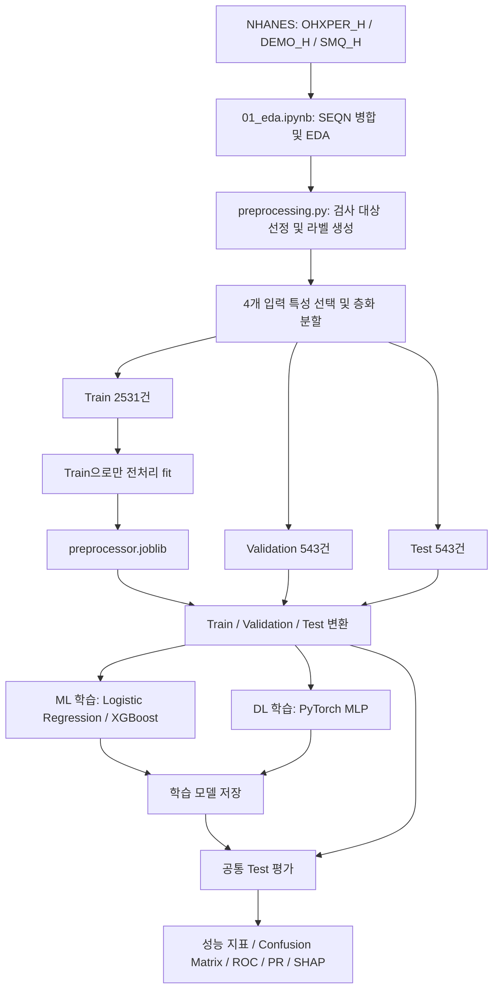

학습에는 Train을 사용하였고 모델 선택 및 학습 중 검증에는 Validation을 사용했습니다.  
Test는 평가용 데이터로 구분했습니다.  
개발 과정에서 중간 Test 결과 확인 후 임계값을 재조정했기에 최종 수치는 완전히 독립적인 확증 평가로 해석하지는 않았습니다.  
원래는 임계값이 3모델 모두 0.5였으나 현재는 0.3으로 조정했습니다.   

### 서비스 추론 파이프라인

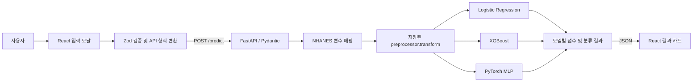

서버 시작 시 전처리 객체와 세 모델을 로딩만 하고 요청마다 학습을 반복하도록 구현하진 않았습니다.  
환자의 개인정보를 저장하고 싶지 않아서 서비스에도 별도 사용자 데이터베이스를 구성하지 않았습니다.  

## 6. EDA 및 전처리

1. 세 XPT 파일을 읽고 참가자 식별자 `SEQN`을 기준으로 치주검사 자료에 인구통계 및 흡연 정보 결합
2. 연령 분포, 검사 상태, 치주낭 깊이 및 결측값을 확인
3. 치주검사 완료 대상자(`OHDPDSTS = 1`)만 선택
4. 인접면 CAL/PD 측정값 중 0~20 범위를 벗어난 값을 결측값으로 처리하고 두 측정 종류 모두 평가 가능한 참가자를 유지
5. 연구용 이진 라벨을 생성하고 네 개의 입력 변수만 선택
6. 흡연 설문 응답 거부 및 모름 코드(7, 9)를 결측값으로 처리
7. 층화 표본 분할(70:15:15, random_state=42)을 적용
8. 수치형 변수는 중앙값 대치 및 표준화, 범주형 변수는 결측값 별도 범주(-1) 및 One-Hot Encoding을 적용  
   (전처리 객체는 Train에서만 fit하고 Validation/Test와 서비스에서는 transform만 수행)

### 데이터 구성

| 단계                     |           건수 |
| ------------------------ | -------------: |
| 병합 데이터              |          4,669 |
| 치주검사 완료 대상자     |          3,982 |
| 라벨 생성 후 최종 데이터 |          3,617 |
| target 0                 | 2,334 (64.53%) |
| target 1                 | 1,283 (35.47%) |

| 분할       |  건수 | 전처리 후 특성 수 |
| ---------- | ----: | ----------------: |
| Train      | 2,531 |                10 |
| Validation |   543 |                10 |
| Test       |   543 |                10 |

## 7. 모델 설계

| 모델                | 설계 목적 및 적용 방법                                                        |
| ------------------- | ----------------------------------------------------------------------------- |
| Logistic Regression | 선형 분류 기준 모델, max_iter=1000                                            |
| XGBoost             | 비선형 관계를 학습하는 트리 부스팅 모델, max_depth 및 learning_rate 후보 비교 |
| PyTorch MLP         | 완전 연결 신경망 기반 이진 분류, ReLU 및 Dropout 적용                         |

### PyTorch MLP 구조

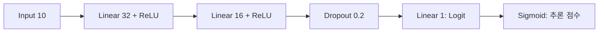

- 손실 함수: BCEWithLogitsLoss
- Optimizer: Adam (learning rate 0.001)
- 최대 Epoch: 100 / Early Stopping patience: 10
- 저장: 검증 손실 기준 최적 가중치의 state_dict
- 검증 데이터에서 0.2~0.6의 임계값을 비교하여 양성 사례 탐지에 가장 좋은 결과를 낸 0.3을 선택했습니다.
- 이후 ML 모델에도 동일 임계값을 적용하였습니다.

## 8. 모델 성능 평가

**2026.11.26 재평가 기록 - Test 543건 공통 threshold 0.3**

| Model               |         Accuracy |        Precision |           Recall |         F1-score |          ROC-AUC |               AP |
| ------------------- | ---------------: | ---------------: | ---------------: | ---------------: | ---------------: | ---------------: |
| Logistic Regression |           0.5746 |           0.4369 | **0.7031** | **0.5389** | **0.6628** | **0.5366** |
| XGBoost             |           0.5709 |           0.4305 |           0.6615 |           0.5216 |           0.6326 |           0.5021 |
| PyTorch MLP         | **0.5838** | **0.4422** |           0.6771 |           0.5350 |           0.6557 |           0.5360 |

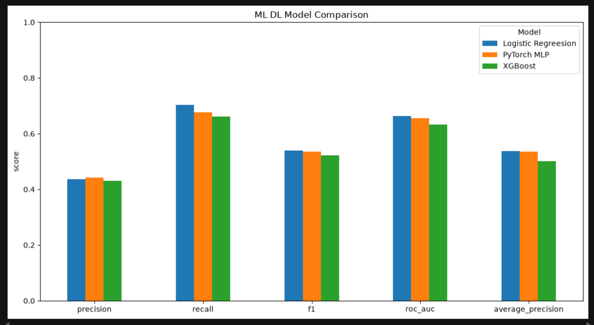

- Logistic Regression이 Recall, F1-score, ROC-AUC, AP에서 가장 높은 결과를 기록
- MLP는 Accuracy와 Precision에서 가장 높은 결과를 보였지만 차이는 작음
- 임계값을 낮추면서 양성 탐지 비율이 증가하였으나 위양성 부담도 증가

### ROC 및 Precision-Recall 곡선

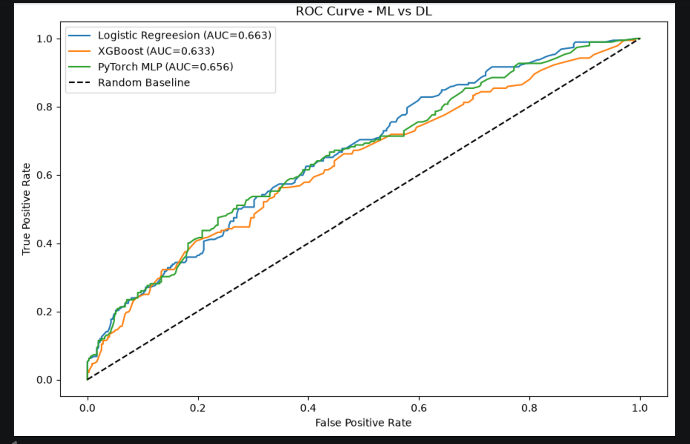

| Logistic Regression             | XGBoost                           | PyTorch MLP                       |
| ------------------------------- | --------------------------------- | --------------------------------- |
| 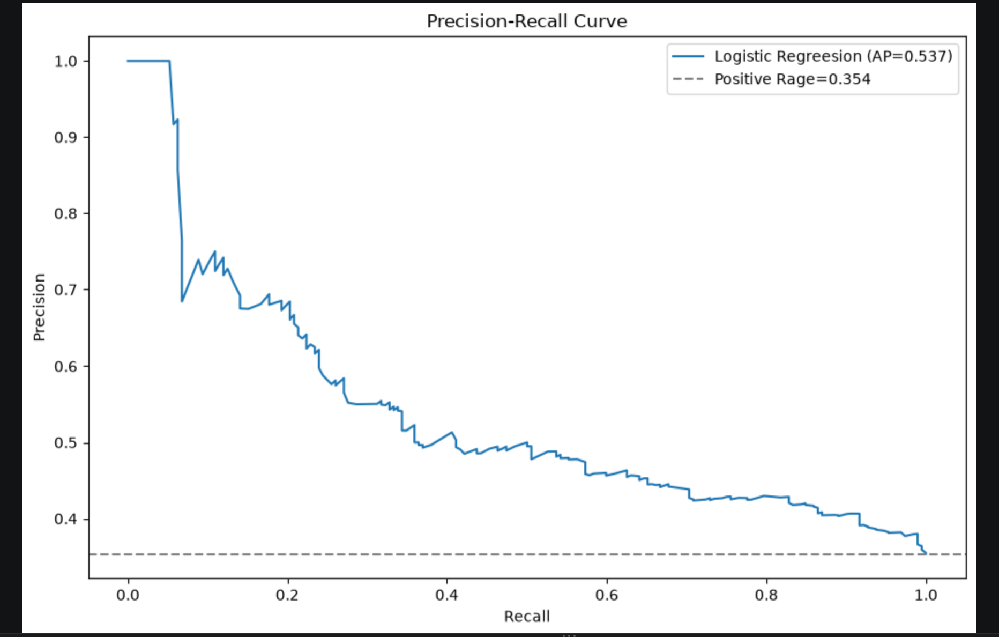 | 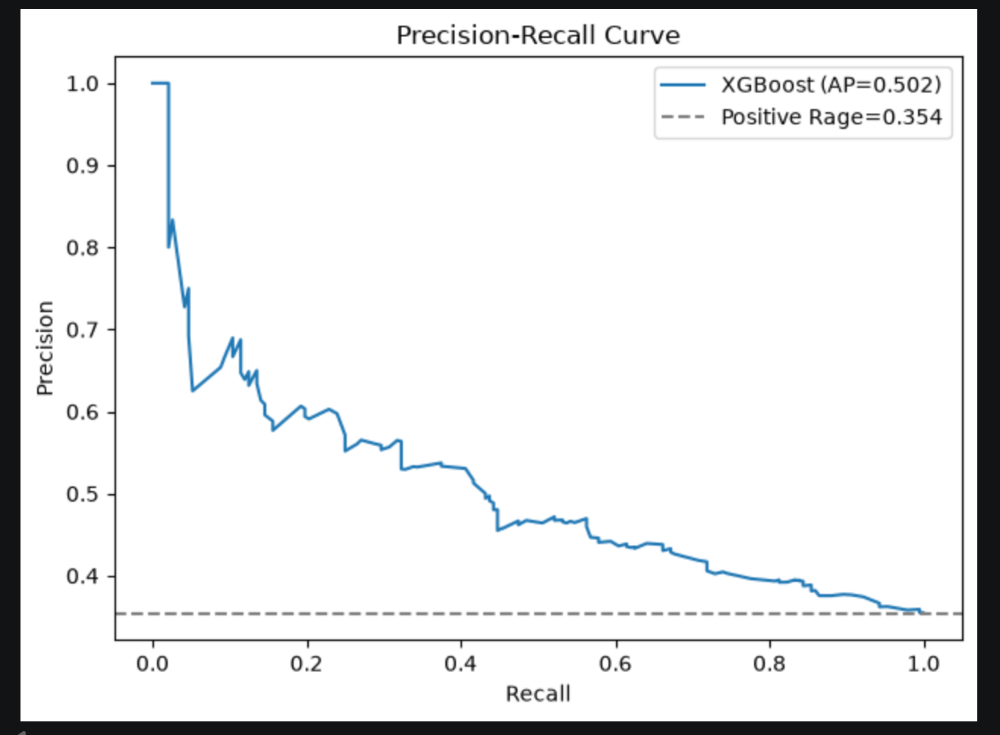 | 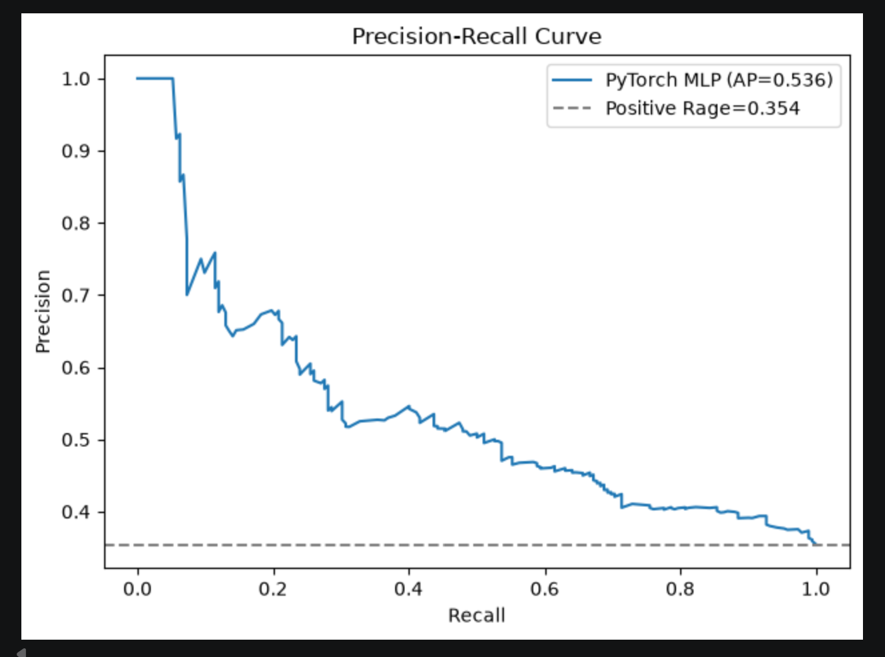 |

Confusion Matrix로 TP/TN/FP/FN을 확인한 뒤 ROC-AUC 및 AP로 점수의 분류 성능을 비교했습니다.

### SHAP 분석

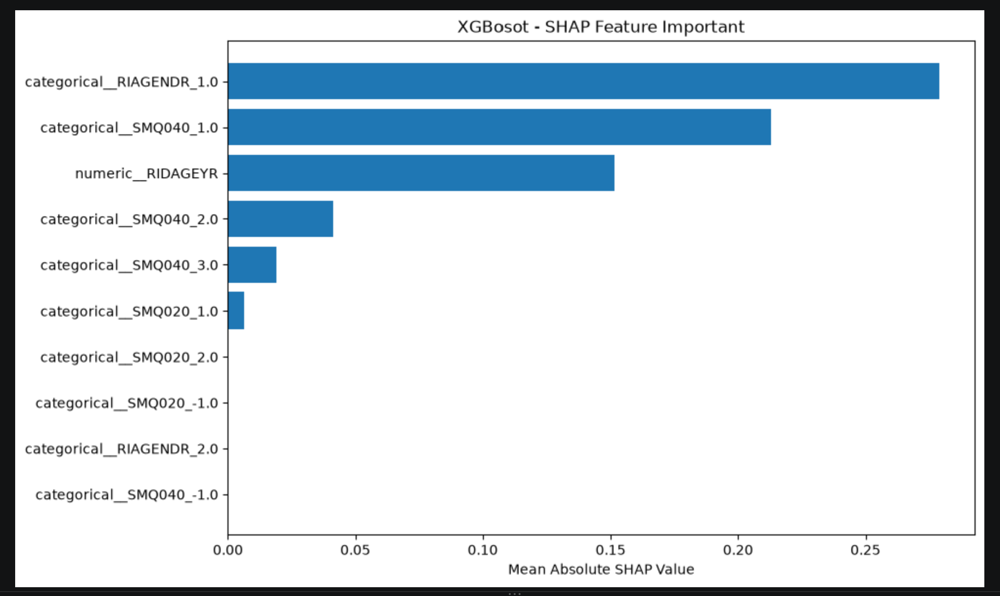

XGBoost의 TreeExplainer와 평균 절대 SHAP 값을 활용해 전처리된 특성별 예측 기여도를 비교했습니다. 개발일지에서는 성별 관련 특성이 높은 중요도를 나타냈습니다. 이는 해당 모델이 예측에 활용한 특성을 보여 주는 것이며 치주질환의 인과관계나 실제 위험요인 순위를 증명하지 않습니다.

## 9. API 및 서비스 화면

| Method | Endpoint     | 역할                                         |
| ------ | ------------ | -------------------------------------------- |
| GET    | `/health`  | 서버 및 모델 로딩 상태 확인                  |
| POST   | `/predict` | 네 입력 변수에 대한 세 모델의 예측 결과 반환 |

요청 형식 예시(가상 입력):

```json
{
  "age": 45,
  "gender": 2,
  "ever_smoked": 1,
  "smoking_frequency": 2
}
```

응답은 `logistic_regression`, `xgboost`, `pytorch_mlp` 각 객체의 `probability`, `prediction`, `threshold` 및 `disclaimer`를 포함합니다.

### 입력 화면

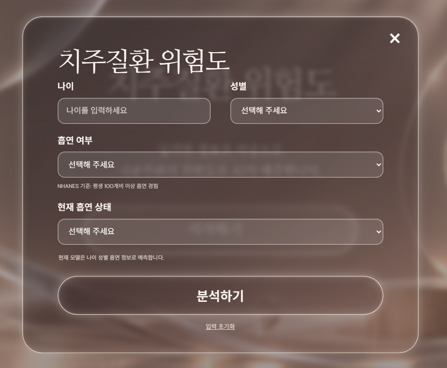

### 예측 결과 화면

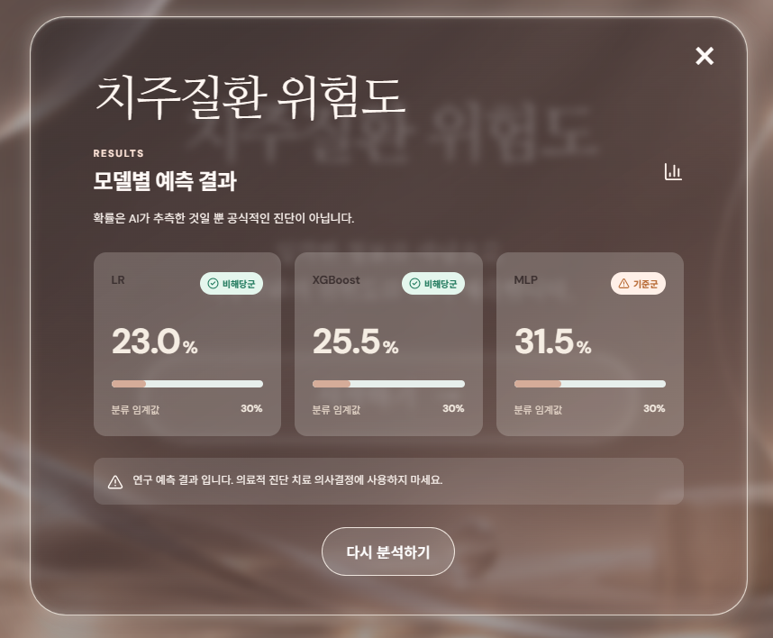

위 화면은 11월 27일 개발 과정의 실제 UI 캡처이며 수치는 예시 화면의 개별 추론 결과입니다. 모델 전체 성능이나 임상적 위험도를 의미하지 않습니다. 이후 코드 변경에 따른 최신 화면과 데모는 추가 예정입니다.

### 데모 영상

> 촬영 및 검증 후 영상 링크 추가 예정

<!-- TODO: 데모 영상 URL 및 실행 환경 추가 -->

## 10. 구현 과정에서 해결한 문제

| 문제                     | 해결 방향                                                             |
| ------------------------ | --------------------------------------------------------------------- |
| 데이터 결합 및 컬럼 오류 | 파일 경로와 식별자 및 실제 컬럼 확인, 병합 코드 수정                  |
| 낮은 양성 재현율         | Validation에서 임계값 후보 비교, 0.3 적용 및 모델별 평가              |
| 평가와 시각화의 결합     | 평가 스크립트와 Notebook 역할 분리 및 실행 경로 확인                  |
| FastAPI 실행 오류        | lifespan에 asynccontextmanager 적용                                   |
| API 입력 형식 오류       | 프론트엔드 필드명과 Pydantic 요청 스키마 대조                         |
| 서비스 추론 전처리 오류  | 모델 학습 시 사용한 전처리 객체 재사용 및 수치 자료형 정합성 확보     |
| 사용자 오류 안내         | 개발자용 콘솔 정보와 사용자용 메시지 구분, 서버 중단 상황 확인        |
| UI/UX 개선               | 화면 시안 비교, 모달·결과 카드 디자인 개선, 입력 및 초기화 흐름 정리 |

## 11. 프로젝트 구조

```text
 gangnyengi-ai/
 ├── notebooks/          # EDA 및 평가 시각화
 ├── src/
 │   ├── preprocessing.py
 │   └── evaluation.py
 ├── ml/train_ml.py
 ├── dl/
 │   ├── model.py
 │   └── train_dl.py
 ├── backend/
 │   ├── main.py
 │   └── schemas.py
 ├── frontend/           # React + TypeScript
 ├── data/               # 원본 및 전처리 데이터 (로컬 생성)
 ├── models/             # 학습된 모델 및 전처리 객체 (로컬 생성)
 ├── results/            # 평가 결과 (로컬 생성)
 ├── requirements.txt
 └── README.md
```

## 12. 실행 방법

Python 3.12 및 Node.js 환경이 필요합니다. 학습 산출물이 없는 경우 원본 데이터를 내려받아 전처리 및 모델 학습부터 진행합니다.

```bash
python -m pip install -r requirements.txt
```

NHANES XPT 파일 세 개를 `data/raw/`에 배치한 후 `notebooks/01_eda.ipynb`를 실행하여 병합 데이터를 생성합니다.

```bash
python src/preprocessing.py
python ml/train_ml.py
python dl/train_dl.py
python src/evaluation.py
```

백엔드:

```bash
python -m uvicorn main:app --app-dir backend --reload --port 8000
```

프론트엔드(별도 터미널):

```bash
cd frontend
npm install
npm run dev
```

환경변수 및 CORS 허용 출처는 로컬 실행 환경에 맞게 설정해야 합니다. 위 명령은 개발일지와 저장소 구조에 따른 실행 안내이며 이 문서 작성 시점에 새 환경에서 재현 검증하지 않았습니다.

### Docker 실행

> 컨테이너 빌드 및 실행 검증 후 작성 예정

<!-- TODO: Dockerfile, Compose 구성, 환경변수, 빌드/실행 명령 및 검증 결과 -->

## 13. 모델의 한계 및 개선 방향

- **제한된 입력 정보:** 연령, 성별, 흡연 관련 정보만 사용하며 당뇨, 구강 위생, 기타 임상 요인을 반영하지 않습니다.
- **조사 설계 제약:** NHANES의 SMQ040은 평생 100개비 이상 흡연 경험이 없는 경우 조사상 결측이 될 수 있어 해당 집단의 현재 흡연 상태를 기존 모델에 반영할 수 없습니다.
- **평가 한계:** 동일 조사 주기의 분할 평가이며 독립 외부 검증 및 확률 보정은 확인되지 않았습니다. Test 결과를 확인한 뒤 임계값을 변경한 개발 이력도 있으므로 새로운 홀드아웃 평가가 필요합니다.
- **일반화 및 대표성:** 미국 조사 데이터로 학습했으며 국내 인구 또는 다른 시기의 환자 집단에 동일하게 적용할 수 있는지 검증되지 않았습니다. 조사 가중치를 반영한 인구 수준 추정도 본 프로젝트 범위에 포함하지 않습니다.
- **임상적 타당성:** 연구용 라벨은 확정 진단과 동일하지 않고 단면조사 자료이므로 미래 발병 위험을 직접 추정하지 않습니다.
- **개선 계획:** 입력 변수 확대, 새로운 독립 검증 데이터 확보, 임계값 및 확률 보정 평가, 하위 집단별 성능 검토, Docker 기반 재현성 검증.

## 14. 개발 과정

| 날짜  | 주요 작업                                               |
| ----- | ------------------------------------------------------- |
| 11.21 | 데이터 수집 및 EDA                                      |
| 11.22 | 전처리 및 학습 데이터 구축                              |
| 11.23 | Logistic Regression 및 XGBoost 학습                     |
| 11.24 | PyTorch MLP 설계 및 학습                                |
| 11.25 | MLP 임계값 조정, 모델 평가 및 SHAP 분석                 |
| 11.26 | 공통 임계값 재평가, 평가 코드 분리, FastAPI·React 연동 |
| 11.27 | UI/UX 개선 및 오류 안내 정리                            |
| 11.28 | 프론트엔드 코드 학습 및 흡연 입력 처리 개선, 문서 정리  |

---

데이터 출처: [CDC NHANES](https://wwwn.cdc.gov/nchs/nhanes/Default.aspx) · [GitHub 저장소](https://github.com/sojung627/gangnyengi-ai)
